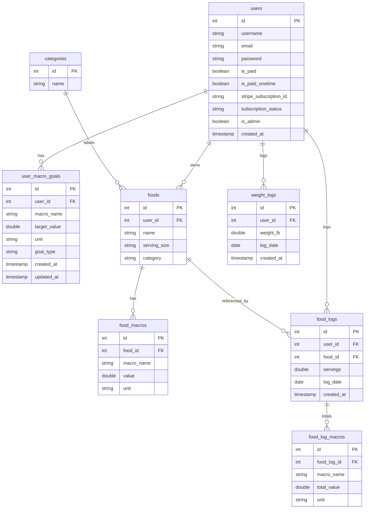

# MacroZapp Architecture

## Overview
- Frontend: React + TypeScript (CRA) in frontend/.
- Backend: Node.js + Express + Knex in backend/.
- Database: Postgres (Knex migrations).
- Payments: Stripe (subscription + one-time).
- Food lookup: Edamam Food Database API (premium).

## Runtime Topology
- Browser -> frontend (CRA dev server).
- frontend -> backend REST API.
- backend -> Postgres (Knex).
- backend -> Stripe + Edamam.

## Local Dev Start (manual)
1) Backend
   - cd backend
   - npm install
   - npm start
2) Frontend
   - cd frontend
   - npm install
   - npm start

Notes:
- Frontend proxies API to http://localhost:4000.
- Backend listens on PORT=4000 by default.

## API Surface Map

Auth
- POST /api/login
- POST /api/signup
- POST /api/reset-password
- POST /api/reset-password-confirm

Free / Core Features
- GET /api/food_logs/goals/:user_id
- POST /api/food_logs/goals
- PUT /api/food_logs/goals/:user_id/:macro_name
- DELETE /api/food_logs/goals/:user_id/:macro_name
- GET /api/food_logs/foods?user_id=...
- POST /api/food_logs/foods
- POST /api/food_logs/:user_id/:date (daily summary)
- GET /api/food_logs/detailed/:user_id/:date
- GET /api/food_logs/range/:user_id/:start_date/:end_date
- POST /api/food_logs/food_logs (log food)
- POST /api/food_logs/weight_logs (log weight)
- GET /api/weight_logs?user_id=...&date=...
- GET /api/weight_logs/range?user_id=...&start_date=...&end_date=...
- GET /api/categories
- POST /api/categories
- PUT /api/categories/:id
- DELETE /api/categories/:id

Food Maintenance (separate router)
- GET /api/foods/foods?user_id=...
- POST /api/foods/foods
- PUT /api/foods/foods/:id
- DELETE /api/foods/foods/:id

Premium (subscription)
- GET /api/premium_1/me
- GET /api/premium_1/food-lookup
- POST /api/premium_1/food-nutrients
- POST /api/premium_1/create-checkout-session (subscription)
- GET /api/premium_1/verify-payment
- POST /api/premium_1/cancel-subscription
- POST /api/premium_1/admin/set-paid (admin)
- POST /api/premium_1/webhook (Stripe)

One-time payment
- GET /api/auth/me
- POST /api/auth/create-checkout-session (one-time)
- GET /api/auth/verify-payment

## Data Model (from migrations)

### Core entities
- users
- user_macro_goals
- foods
- food_macros
- food_logs
- food_log_macros
- weight_logs
- categories
- master_foods, master_food_macros (seeded base foods)

### ERD (Mermaid)

## Frontend Routing
- Public: /, /login, /signup, /reset-password, /privacy, /terms, /reset-password-confirm
- Public with Nav: /payment, /payment-success, /payment-cancel, /payment-onetime, /payment-success-onetime
- Protected: /app/dashboard, /app/goals, /app/food-maintenance, /app/logs, /app/settings

## Key Flows
- Login -> token in localStorage -> AuthContext fetches /api/premium_1/me.
- Daily summary -> POST /api/food_logs/:user_id/:date.
- Logging food -> POST /api/food_logs/food_logs with food_id, servings, log_date.
- Premium lookup -> /api/premium_1/food-lookup and /api/premium_1/food-nutrients.
- Subscription -> /api/premium_1/create-checkout-session -> Stripe -> /api/premium_1/verify-payment.
- One-time -> /api/auth/create-checkout-session -> Stripe -> /api/auth/verify-payment.

## Refactor / Risk Checklist (priority order)
1) JWT verification: some middleware decodes without verify (auth trust). Convert to jwt.verify.
2) Route duplication: food_logs.js and foods.js overlap heavily; choose one canonical router.
3) Env var drift: REACT_APP_API_URL vs REACT_APP_API_BASE_URL; unify naming.
4) Mixed DB access: req.app.get('db') vs direct require('../db'); standardize.
5) Logging/debug: many console logs in production paths; wrap with env guard.
